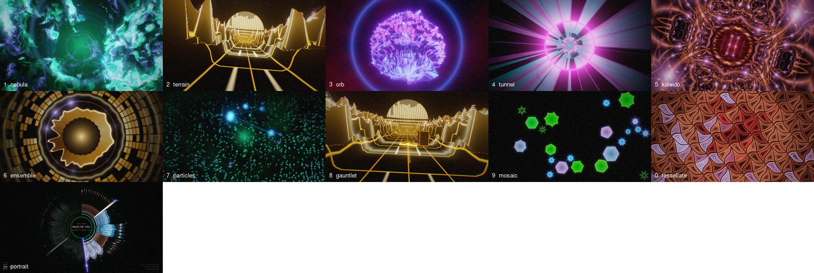
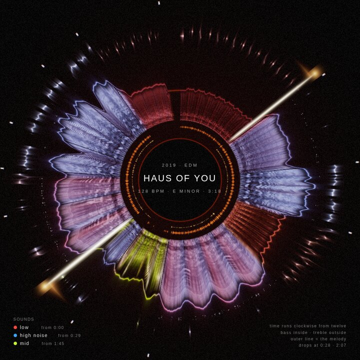

# Music Shader

A music visualizer that listens closely. It hears **kicks, snares/claps and hi-hats**
separately, follows **timbre** (which instrument or synth patch is sounding), the
**melody line** and whether it wavers like a **voice**, the **musical key**, the
**beat and bar**, and **section changes**, and drives GLSL scenes with all of it. Built for making videos you'd upload: every scene is tuned for
dark, contrasty, bloom-lit frames, and export renders frame-exact MP4s.

Because it analyses the whole song first, it also knows **where the song is going**: the picture
holds back through each build-up and bursts on the drop. It finds the song's **recurring sounds**
and gives each one colour, the same in every scene. And it draws the whole song as one
**portrait** you can export as a poster.



## Quick start

```bash
just install        # or: npm ci
just dev            # http://localhost:5173
just open           # (WSL) opens it in Windows Chrome, which has your real GPU
```

Pick a song under **Music → Library** (served from `MUSIC_DIR`, default
`../deluge-quest/web/public/audio`), drop any audio file on the page, or press <kbd>O</kbd>.
Analysis takes a few seconds per song, then press <kbd>Space</kbd>.

The same app deploys to GitHub Pages (`.github/workflows/pages.yml`) at
<https://shader.dannybrown.dev> (`public/CNAME`). The public site has no library, so visitors
drop their own audio file.

```bash
MUSIC_DIR=~/Music just dev    # use a different folder
```

## Keys

| Key | Action |
| --- | --- |
| <kbd>Space</kbd> | play / pause |
| <kbd>←</kbd> <kbd>→</kbd> | seek 5 s (<kbd>Shift</kbd>: 30 s) |
| <kbd>1</kbd>–<kbd>9</kbd>, <kbd>0</kbd> | switch scene (loads its built-in preset; <kbd>0</kbd> is scene 10) |
| <kbd>K</kbd> | add a show cue: the current scene from the nearest downbeat |
| <kbd>Del</kbd> | delete the selected show cue |
| <kbd>B</kbd> | browse presets: each rendered at this moment of the song |
| <kbd>T</kbd> | tempo as detected → ×2 → ÷2 (remembered per song) |
| <kbd>C</kbd> | record live: start / stop |
| <kbd>P</kbd> | next palette |
| <kbd>R</kbd> | surprise me: random variation of the current scene (save it if you like it) |
| <kbd>D</kbd> | debug meters: what the analyser hears |
| <kbd>H</kbd> | hide all UI |
| <kbd>F</kbd> | fullscreen |
| <kbd>O</kbd> | open an audio file |

## Scenes

| # | Scene | What drives what |
| --- | --- | --- |
| 1 | **Nebula** | spectrum runs out from the core (bass centre, highs at the rim) · loudness → how thick the smoke is · kick → shockwaves that light the smoke · snare → refracting rings · notes → flares on a clock face by pitch · hats → sparkles · each section → new drift |
| 2 | **Terrain** | the land *is* the last 2 s of spectrum (bass by the road, highs on far peaks) · kick → waves rolling in + sun pulse · sun → equalizer · snare → grid flash · hats → road lights + stars · each section → new camera |
| 3 | **Orb** | a spectrogram globe: frequency by latitude, the last 2 s sweep across the face as lit tiles · timbre → lobes + roughness · snare → spikes · kick → shockwave shells · hats → glints · each section → new camera |
| 4 | **Tunnel** | spectrum lights equalizer tiles round the walls · kick → rings rushing in · snare → twist · hats → light streaks · noisy timbre cracks the tiles · melody → ribbons along the wall at its pitch, carried toward you like the rings (warmer and shimmering when it sounds like a voice) |
| 5 | **Kaleido** | timbre reshapes the fractal crystal · spectrum → rings lit by band (bass centre) · kick → shockwaves through the crystal · bass → zoom · snare → mirror rotation · hats → seam sparks · notes → jewels · each section → new folds + crystal |
| 6 | **Ensemble** | one visual voice per part: kick → rings · snare → shards · hats → sparks · harmony → 12-note wheel on the circle of fifths · spectrum → ring, and its last 2 s ripple outward as lit cells · bass → core |
| 7 | **Particles** | kick → ember bursts · snare → motion-blurred spark fans · hats → glitter · each note → an orb launched from its pitch on the circle of fifths, joined to the previous note (melodies draw constellations) · spectrum → a fountain of motes (bass left) carrying the last 2 s up the screen, flipped by section |
| 8 | **Gauntlet** | Terrain with a ship on the road · each snare → an obstacle rolling in from the horizon: pylons it slides past, spinning mines it blasts with twin lasers (*Shots between dodges* sets the mix) · kick → land waves + sun pulse · hats → lane lights · melody → a line written across the sky (now above the sun, older toward the edges) |
| 9 | **Mosaic** | each kick / snare / note drops a shape wherever it still fits, until the screen is full (then each hit re-flashes the shape most like it); on the next downbeat they all fall away and it starts over (a section change clears it early) · shape = timbre: bright → more corners, noisy → spiky star, pitched → round · colour = instrument (timbre) · kicks solid, snares hollow, notes inset · each shape keeps breathing with its own sound (notes with their pitch) · hats → glints round every edge |
| 0 | **Tessellate** | one tile shape covers the screen and keeps changing · timbre (averaged over the last second) picks the shape: bright → diamonds become Cairo pentagons and long hexagons, noisy → edges bend into interlocking Escher curves, the third axis leans the grid from square toward hexagonal · each snare turns the tiling a notch, kicks pump it · each tile fills with nested outlines as its band gets louder (bass at the centre), crawling inward on the beat · kick → waves of lit tiles · notes → the tiles of their pitch light up · hats → corner glints · each section → new lattice |

| – | **Portrait** | the whole song as one ring, drawn by a pen as it plays: time runs clockwise from twelve, bass inside, the outline breathes with intensity · colour = the sound playing · kicks and snares ring the inside · melody orbits outside · build-ups glow toward each drop, drops fire rays (pick it in the *Scene* list; Auto VJ skips it) |

Every scene also gets trails, bloom, chromatic aberration, auto-exposure, grain and
vignette from the shared post-processing (*Look* folder).

### Build-ups, drops and the song's sounds

```
energy  ▁▁▂▂▃▃▄▅▆▇█ │ ████████
build   0 ────────► 1│ 0          the picture draws back, slows, darkens, drains of colour,
                     │            trails swirl inward
drop                 ▲            flash, punch-in, bloom, a shell racing out; Auto VJ hard-cuts here
```

- **Drops** are downbeats where the energy of the next 2 bars jumps over the last 2. The
  **build-up** runs from the breakdown's trough (4–8 bars) into the drop. Songs that never let
  up have none, which is the point. Live input can't see a drop coming: it only gets the burst,
  about 0.3 s in.
- **Quiet vs loud**: quiet passages react less and sit darker, so the loud parts hit harder.
- **The song's sounds (its cast)**: the pitched part of the mix (drums removed) is grouped
  into 1–6 recurring timbres, numbered in order of entrance. Each keeps one colour everywhere:
  - notes in Nebula, Particles, Tessellate, Mosaic, Kaleido, Ensemble
  - the melody line in Tunnel and Gauntlet
  - the *sounds* lamps in the debug meters and the strip under the timeline
  - the poster

  Darker sounds get warmer colours. A "sound" is a timbre state, not an instrument name:
  two instruments that always play together count as one.



**Song poster**: *Export video → Song poster (PNG)* renders the Portrait at 2160×2160 with the
title, tempo, key, the cast and a key to reading it. With *Portrait outro* on (12 s by default),
the end of every song and export crossfades into the Portrait, which redraws the whole song as a
recap.

**Auto VJ** (checkbox under *Scene*): moves to the next scene at detected section
changes, at most every *N* seconds. The crossfade starts just before the change so the
new scene lands on the drop, and it works in exports too. In loud parts it hard-cuts
on downbeats instead, every 4 bars on the song's phrase grid (*cut on the beat when loud*).
*Look → New look each section* also nudges the scene's parameters at every section.

If a scene stutters, the live view lowers its render resolution automatically and
climbs back when there's headroom (*Look → Render scale* sets the ceiling; the debug
meters show the current %). Exports always render at full resolution.

**Show** (folder *Show (this song)* and the timeline strip above the transport bar): when you
want to choose the scene changes yourself. Each cue switches to a scene (and optionally a
palette) at a time, by crossfade or hard cut. Press <kbd>K</kbd> to drop a cue on the nearest
downbeat, or *Start from Auto VJ's choices* and edit those. Drag cues on the timeline, click
one to edit it. Shows are saved per song and override Auto VJ while *Play this song's show* is
on; exports follow them too.

## Making a YouTube video

1. Load the song, pick a scene/preset, tweak. Optionally build a **show** (above) for the
   scene changes.
2. Optional overlays (all of them end up in the export):
   - *Overlay → Title card*: title and subtitle come from the file name.
   - *Load cover art / logo…* or drop an image: a badge that pulses on kicks, or a dim backdrop.
   - *Load lyrics (.lrc)…* or drop an `.lrc` file: timed lines, one at a time.
3. *Export video*: choose resolution (720p → 4K, vertical, square), 24/30/60 fps, and a
   time range, then **Render video…**. Chrome asks where to save and streams the file to
   disk, so long 4K renders don't need to fit in memory.
4. *Export video → YouTube thumbnail (PNG)*: a 1280×720 still at the song's most intense
   moment, with the title card.

Export is **offline**: frame *i* is rendered at exactly *t = i / fps*, so the video is
perfectly smooth even if your GPU can't do that resolution live. Click the button again
to cancel.

**Record live** (<kbd>C</kbd>, or *Export video → Record live*) is the other way: it
captures the canvas and audio in real time, so scene keys you press, Auto VJ and live
mic/tab input all end up in the video. It records at the window's size and the GPU's
frame rate, so go fullscreen (<kbd>F</kbd>) first and don't resize while recording.
Saves MP4 where Chrome supports it, otherwise WebM; both upload to YouTube.

## Live input

*Music → Live: microphone / line-in* or *Live: tab or system audio*. For tab audio,
Chrome's share dialog needs "Also share tab audio" ticked. Live mode uses a causal
analyser (about 25 ms look-ahead, adaptive normalisation), and the tempo locks after
about 4 s.

## More

- [ARCHITECTURE.md](ARCHITECTURE.md): how audio becomes pixels, with diagrams
- [TWEAKING.md](TWEAKING.md): change the look, the reactivity, the detectors; write a scene
- [JOURNAL.md](JOURNAL.md): build log, decisions, and what is still rough
